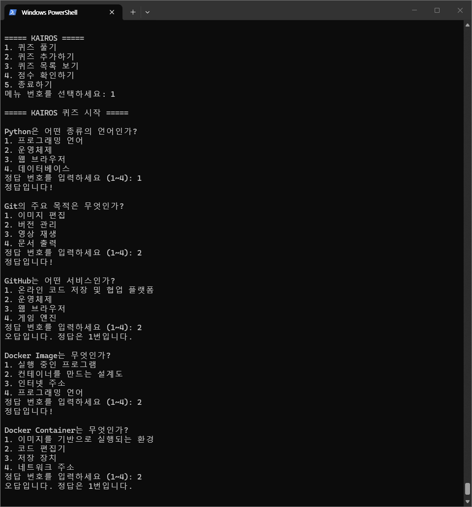
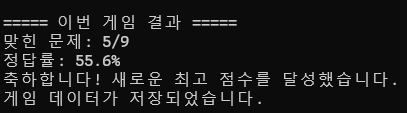
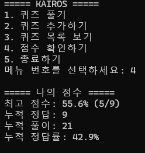
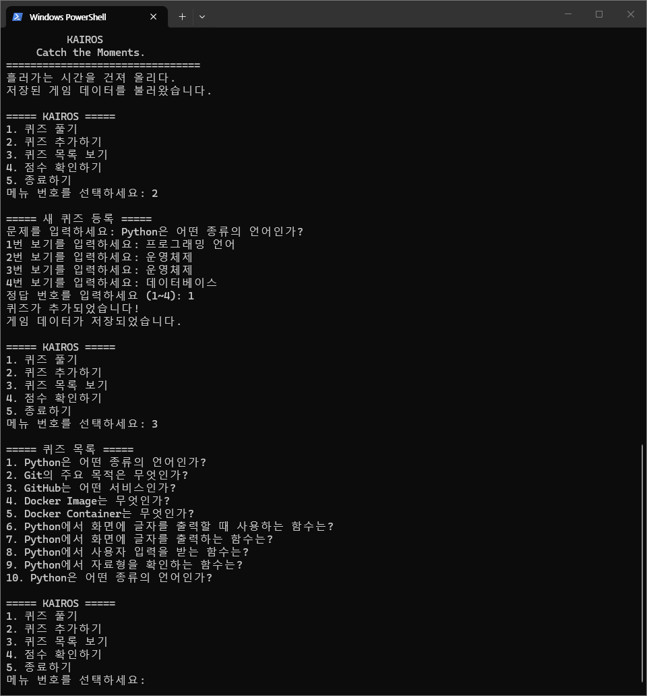
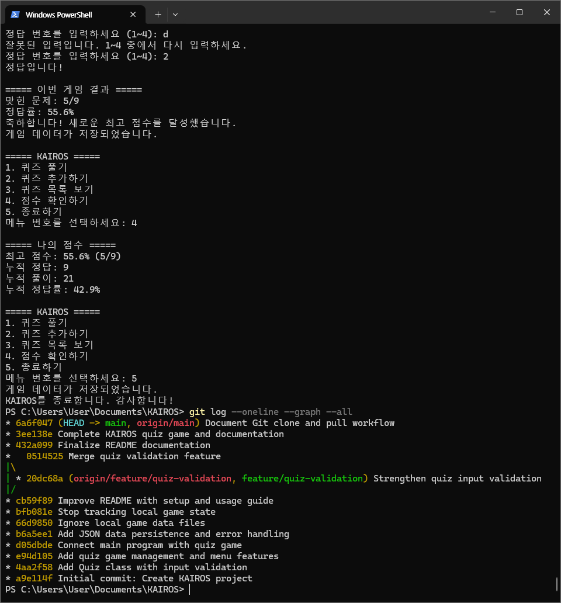
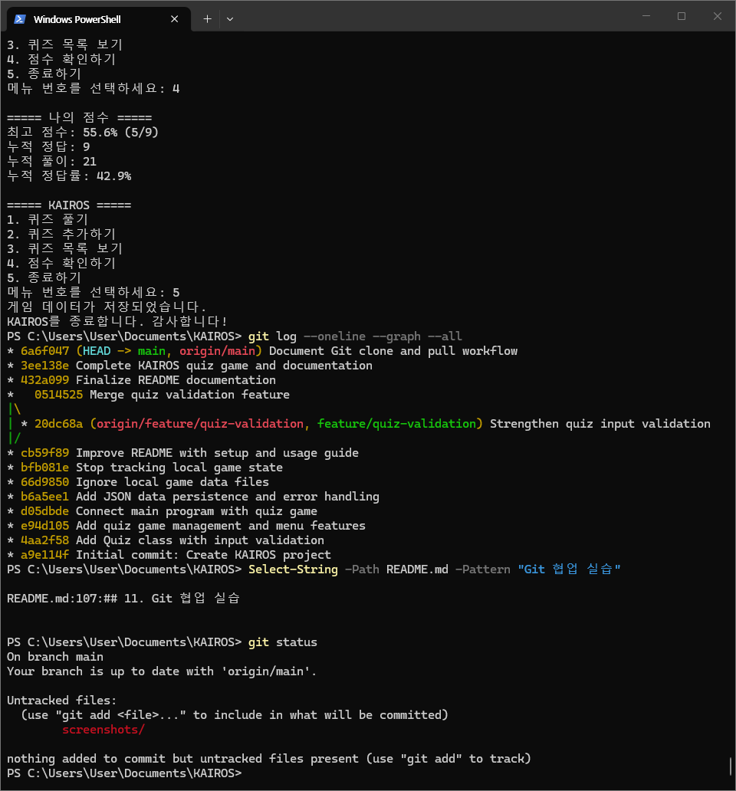

# KAIROS

### Catch the Moments.
**흘러가는 시간을 건져 올리다.**

붙잡지 않으면 흘러가는 시간 속에서, 기억하고 기록하고 복습하는 퀴즈 게임

---

## 1. 프로젝트 소개

KAIROS는 강의를 통해 학습한 내용을 퀴즈로 풀어보며 학습자의 이해도를 확인하고, 반복적인 복습을 통해 학습 효과를 높이는 Python 기반 콘솔 퀴즈 게임이다.

사용자는 등록된 퀴즈를 풀거나 새로운 문제를 추가할 수 있으며, 자신의 누적 점수와 최고 기록을 확인할 수 있다.

## 2. 개발 목적 및 주제 선정 이유

### 개발 목적

- 강의에서 학습한 핵심 개념 복습
- 퀴즈를 통한 학습 이해도 확인
- 반복적인 문제 풀이를 통한 학습 효과 향상
- 게임 기록의 저장 및 관리를 통한 지속적인 학습 지원

### 주제 선정 이유

개발 과정에서 학습한 Python, Git, GitHub, Docker의 핵심 개념을 퀴즈로 구성하였다.

개발 과정에서 접한 주요 용어와 기능을 스스로 점검하고, 반복적인 문제 풀이를 통해 학습 내용을 복습할 수 있도록 주제를 선정하였다.

## 3. 개발 환경

| 항목 | 환경 |
|---|---|
| Programming Language | Python 3.10 이상 |
| Platform | Windows Console |
| Data Storage | JSON |
| Version Control | Git |
| Remote Repository | GitHub |
| External Libraries | Python 표준 라이브러리 |

### 개발 환경 확인

Python 실행 환경과 프로젝트 파일 구성을 확인하였다.


## 4. 주요 기능

### 4-1. 메인 메뉴

프로그램을 실행하면 KAIROS의 시작 화면과 함께 주요 기능을 선택할 수 있는 메뉴가 표시된다.


### 4-2. 퀴즈 목록 조회

등록된 퀴즈를 목록으로 확인할 수 있다. 각 문제와 선택지를 확인하여 게임에 등록된 문제를 관리할 수 있다.


### 4-3. 퀴즈 풀이 및 자동 채점

등록된 퀴즈를 순서대로 풀고, 입력한 답안을 정답과 비교하여 자동으로 채점한다.

모든 문제를 완료하면 전체 문제 수와 정답 및 오답 결과를 확인할 수 있다.





### 4-4. 점수 및 최고 기록 확인

누적 정답 수와 전체 풀이 문제 수를 바탕으로 학습 기록을 확인할 수 있다. 게임별 최고 기록도 관리한다.



### 4-5. 퀴즈 추가

사용자가 새로운 문제와 4개의 선택지, 정답 번호를 입력하여 퀴즈를 추가할 수 있다.

문제와 선택지의 빈칸 및 정답 번호 범위를 검사하여 잘못된 입력을 방지한다.


### 4-6. 데이터 저장 및 불러오기

게임 데이터는 JSON 형식의 `state.json` 파일에 저장된다.

프로그램 종료 시 데이터를 저장하고, 다음 실행 시 기존 데이터를 불러와 이전 기록을 이어서 관리할 수 있다.

## 5. 프로젝트 구조

```text
KAIROS/
├── main.py        # 프로그램 실행 및 기본 퀴즈 등록
├── game.py        # 게임 진행, 점수 관리 및 데이터 처리
├── quiz.py        # Quiz 클래스 및 입력값 검증
├── README.md      # 프로젝트 설명서
├── .gitignore     # Git 제외 파일 설정
├── screenshots/   # 프로젝트 실행 및 개발 증빙 이미지
└── state.json     # 실행 시 생성되는 로컬 게임 데이터
```

## 6. 실행 방법

Python 3.10 이상이 설치된 환경에서 프로젝트 폴더로 이동한 후 다음 명령어를 실행한다.

```bash
python main.py
```

### 메뉴 구성

| 번호 | 기능 | 설명 |
|---|---|---|
| 1 | 퀴즈 풀기 | 등록된 퀴즈 풀이 및 자동 채점 |
| 2 | 퀴즈 추가 | 새로운 퀴즈 등록 |
| 3 | 퀴즈 목록 | 등록된 퀴즈 확인 |
| 4 | 점수 확인 | 누적 점수 및 최고 기록 확인 |
| 5 | 종료 | 게임 데이터 저장 후 프로그램 종료 |

## 7. 데이터 저장 및 관리

게임 데이터는 프로젝트 폴더의 `state.json` 파일에 JSON 형식으로 저장한다.

| 데이터 항목 | 설명 |
|---|---|
| quizzes | 등록된 퀴즈 목록 |
| question | 퀴즈 문제 |
| choices | 선택지 |
| answer | 정답 번호 |
| score | 누적 정답 수 |
| total_questions | 누적 풀이 문제 수 |
| best_score | 최고 정답률 |
| best_correct | 최고 기록 당시 정답 수 |
| best_total | 최고 기록 당시 전체 문제 수 |

`state.json`은 사용자별 게임 데이터를 보관하는 로컬 파일이며, `.gitignore`에 등록하여 GitHub 저장소에는 업로드하지 않는다.

## 8. 테스트 및 검증

프로그램의 정상 작동과 입력값 검증, 데이터 저장 및 불러오기 등을 확인하였다.

| 테스트 항목 | 검증 내용 |
|---|---|
| 프로그램 실행 | 메인 화면 및 메뉴 작동 확인 |
| 퀴즈 풀이 | 문제 출력 및 답안 입력 확인 |
| 자동 채점 | 정답 및 오답 판정 확인 |
| 퀴즈 추가 | 신규 문제 등록 확인 |
| 퀴즈 목록 | 등록된 문제 조회 확인 |
| 점수 관리 | 누적 점수 및 최고 기록 확인 |
| 데이터 저장 | JSON 파일 저장 및 불러오기 확인 |
| 입력값 검증 | 빈 입력 및 잘못된 정답 번호 처리 |
| 예외 처리 | 손상된 JSON 파일 및 안전한 종료 처리 |
| Python 문법 검사 | `py_compile` 실행 확인 |
| Git 변경 사항 검사 | `git diff --check` 실행 확인 |

## 9. Git 및 GitHub 버전 관리

Git을 이용하여 소스 코드를 관리하고 GitHub 원격 저장소에 프로젝트를 업로드하였다.

### 9-1. 버전 관리 및 브랜치 실습

- 기능 개발을 위한 별도 브랜치 생성
- 변경 사항 커밋
- 브랜치 병합 및 원격 저장소 반영
- 커밋 기록 관리



### 9-2. Clone 및 Pull 실습

GitHub 원격 저장소를 별도의 로컬 폴더에 복제한 후 README를 수정하고 Commit 및 Push를 진행하였다.

이후 기존 작업 폴더에서 Pull을 실행하여 원격 저장소의 변경 사항이 정상적으로 동기화되는지 확인하였다.



### GitHub 저장소

[SeoyoungShim / KAIROS](https://github.com/SeoyoungShim/KAIROS)

## 10. 개발 결과

KAIROS는 퀴즈 등록, 풀이, 자동 채점, 점수 관리 및 데이터 저장 기능을 갖춘 콘솔 기반 학습 이해도 확인 프로그램으로 개발되었다.

사용자가 직접 퀴즈를 추가하고 게임 기록을 저장할 수 있도록 구현하였으며, Git과 GitHub를 활용하여 소스 코드의 버전 관리 및 원격 저장소 협업 실습을 진행하였다.

**Development Status: Completed**