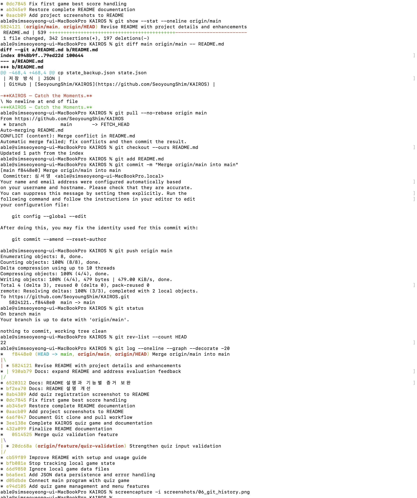

# KAIROS
### Catch the Moments.
**흘러가는 시간을 건져 올리다.**

---

## 1. 프로젝트 소개

KAIROS는 Python을 활용하여 개발한 콘솔 기반 퀴즈 게임 프로젝트입니다.


본 프로젝트는 학습한 내용을 재미있게 복습하고, 퀴즈를 통해 학습자의 이해도를 확인할 수 있도록 기획되었습니다.
교수자가 강의 후 학생들의 학습 성취도를 확인하거나, 학생이 자기주도학습을 위해 학습 내용을 복습하는 데 활용할 수 있습니다.
또한 종교 활동에서 예배 후 소모임이나 구성원 간의 교류를 위한 퀴즈 활동에도 활용할 수 있습니다.

## 2. 개발 환경

| 구분 | 사용 기술 및 환경 |
|---|---|
| 프로그래밍 언어 | Python |
| Python 버전 | Python 3.10 이상 |
| 개발 환경 | macOS / Windows |
| 데이터 저장 | JSON |
| 버전 관리 | Git |
| 원격 저장소 | GitHub |
| 외부 라이브러리 | 별도 설치 없이 Python 표준 라이브러리 사용 |

---

## 3. 주요 기능

| 기능 | 설명 | 구현 상태 |
|---|---|---|
| 퀴즈 풀이 | 다양한 주제의 퀴즈를 풀고 정답 여부와 점수를 확인할 수 있습니다. | 구현 완료 |
| 퀴즈 추가 | 사용자가 직접 새로운 문제와 정답을 등록하여 퀴즈 목록을 확장할 수 있습니다. | 구현 완료 |
| AI 기반 문제 자동 생성 | 강의 자료나 요약본을 업로드하면 AI가 학습 내용에 적합한 문제를 자동으로 생성하는 기능입니다. | 향후 개발 예정 |
| 게임 기록 관리 | 사용자의 점수와 누적 게임 기록을 확인할 수 있습니다. | 구현 완료 |
| 데이터 저장 및 불러오기 | JSON 파일을 활용하여 프로그램 종료 후에도 기존 퀴즈와 게임 데이터를 유지합니다. | 구현 완료 |
| 입력값 검증 및 예외 처리 | 잘못된 입력이나 예상치 못한 상황에 대응하여 프로그램이 안정적으로 작동하도록 합니다. | 구현 완료 |

## 4. 프로그램 실행 방법

### 4-1. 저장소 복제

터미널에서 다음 명령어를 입력한다.

```bash
git clone https://github.com/SeoyoungShim/KAIROS.git
```

### 4-2. 프로젝트 폴더 이동

```bash
cd KAIROS
```

### 4-3. 프로그램 실행

```bash
python3 main.py
```

Windows 환경에서는 다음 명령어를 사용할 수 있다.

```bash
python main.py
```

별도의 외부 라이브러리 설치 없이 실행할 수 있다.

---

## 5. 프로그램 메뉴 구성

프로그램을 실행하면 다음과 같은 메뉴가 출력된다.

```text
================================
          KAIROS
     Catch the Moments.
================================
흘러가는 시간을 건져 올리다.

1. 퀴즈 풀기
2. 퀴즈 추가하기
3. 퀴즈 목록 보기
4. 점수 확인하기
5. 종료하기
```

사용자는 원하는 메뉴 번호를 입력하여 각 기능을 이용할 수 있다.

---

## 6. 프로젝트 파일 구조

```text
KAIROS/
│
├── main.py
│   └── 프로그램 시작 및 기본 퀴즈 생성
│
├── game.py
│   └── QuizGame 클래스 및 게임 진행 기능
│
├── quiz.py
│   └── Quiz 클래스 및 개별 퀴즈 기능
│
├── state.json
│   └── 게임 데이터 저장 파일
│
├── screenshots/
│   └── 프로그램 실행 및 개발 과정 증거 이미지
│
└── README.md
    └── 프로젝트 설명 및 사용 안내
```

※ `state.json`은 실행 과정에서 생성·관리되는 로컬 데이터 파일이며, GitHub 저장소에서는 별도로 추적하지 않는다.

---

## 7. 객체지향 프로그래밍 구조

KAIROS는 기능별 책임을 분리하기 위해 `Quiz`와 `QuizGame` 두 개의 클래스를 사용한다.

### 7-1. Quiz 클래스

`quiz.py`에서 개별 퀴즈의 정보를 관리한다.

| 메서드 | 역할 |
|---|---|
| `__init__()` | 질문, 선택지, 정답 정보 초기화 |
| `display()` | 문제와 선택지 출력 |
| `check_answer()` | 사용자가 입력한 답의 정오답 확인 |

### 7-2. QuizGame 클래스

`game.py`에서 전체 게임의 흐름과 데이터를 관리한다.

| 메서드 | 역할 |
|---|---|
| `__init__()` | 게임 객체 초기화 |
| `add_quiz()` | 퀴즈 목록에 새로운 문제 추가 |
| `show_quizzes()` | 등록된 퀴즈 목록 출력 |
| `get_answer()` | 사용자 답변 입력 처리 |
| `play()` | 퀴즈 진행 및 결과 처리 |
| `show_score()` | 점수와 누적 기록 출력 |
| `create_quiz()` | 새로운 퀴즈 생성 |
| `save_data()` | 게임 데이터를 JSON 파일에 저장 |
| `load_data()` | JSON 파일에서 게임 데이터 불러오기 |
| `run()` | 메뉴 출력 및 사용자 선택에 따른 기능 실행 |

### 7-3. main.py

`main.py`는 프로그램의 시작점이다.

- `create_default_quizzes()` 함수로 기본 퀴즈 5개를 생성한다.
- `QuizGame` 객체를 생성한다.
- 등록된 퀴즈가 없으면 기본 퀴즈를 추가한다.
- `game.run()`을 호출하여 게임을 시작한다.


### 7-4. 함수형 프로그래밍과 객체지향 프로그래밍 비교

같은 퀴즈 프로그램도 함수를 중심으로 작성하거나 클래스를 중심으로 작성할 수 있다.

**① 함수형 방식**

함수형 방식은 데이터를 함수에 전달하여 각각의 기능을 실행하는 방식이다.

예를 들어 `check_answer(user_answer, correct_answer)`라는 함수를 만들면 사용자의 답과 정답을 전달하여 정오답을 확인할 수 있다.

- 기능을 작은 함수로 나누어 작성하기 쉽다.
- 간단한 작업을 처리하기에 적합하다.
- 여러 기능에서 같은 데이터를 사용하면 필요한 데이터를 각 함수에 전달해야 한다.

**② 객체지향 방식**

객체지향 방식은 관련된 데이터와 기능을 클래스 안에 함께 구성하는 방식이다.

KAIROS의 `Quiz` 클래스는 질문, 선택지, 정답을 하나의 객체로 관리하며 `check_answer()` 메서드로 정답을 확인한다.

- 관련 데이터와 기능을 하나로 묶어 관리할 수 있다.
- 객체별로 역할을 구분하기 쉽다.
- 기능이 늘어나도 구조를 파악하고 유지보수하기 편리하다.

**③ 두 방식의 차이와 KAIROS의 선택**

| 비교 항목 | 함수형 방식 | 객체지향 방식 |
|---|---|---|
| 중심 요소 | 함수 | 클래스와 객체 |
| 데이터 관리 | 함수에 데이터를 전달 | 객체 내부에 데이터 저장 |
| 기능 관리 | 여러 함수를 개별 작성 | 관련 기능을 메서드로 구성 |
| 활용 예시 | 정답 확인 함수 | Quiz 클래스 |

**실제 코드 비교 예시**

- 함수형 방식: `def check_answer(user_answer, correct_answer): return user_answer == correct_answer`처럼 정답과 사용자 답을 함수에 직접 전달한다.
- 객체지향 방식: KAIROS의 `Quiz.check_answer(self, answer)`는 객체 안에 저장된 `self.answer`와 전달받은 답을 비교한다.
- 게임 관리: `QuizGame`은 `play()`, `show_score()`, `save_data()`, `load_data()` 등의 메서드로 게임 진행과 점수 및 데이터 저장을 관리한다.

KAIROS는 개별 퀴즈 정보와 전체 게임 진행 정보를 함께 관리해야 하므로 객체지향 방식을 선택하였다.

`Quiz`는 개별 문제를 관리하고, `QuizGame`은 퀴즈 목록, 점수, 게임 진행 및 데이터 저장을 담당한다. 이처럼 책임을 나누면 코드의 역할을 명확하게 이해하고 관리할 수 있다.

---

## 8. 데이터 저장 방식

KAIROS는 JSON(JavaScript Object Notation) 형식을 사용하여 게임 데이터를 저장한다.

JSON은 사람이 읽고 수정하기 쉬운 데이터 형식으로, Python의 기본 기능을 활용하여 데이터를 저장하고 불러올 수 있다.

### 데이터 처리 과정

1. 프로그램 실행 시 `load_data()`를 통해 저장된 데이터를 불러온다.
2. 사용자가 퀴즈를 풀거나 새로운 문제를 추가한다.
3. 변경된 게임 데이터를 `save_data()`를 통해 JSON 파일에 저장한다.
4. 다음 실행 시 저장된 데이터를 다시 불러온다.

### JSON 저장 방식의 장점

- 별도의 데이터베이스 설치가 필요하지 않다.
- 데이터 구조를 쉽게 확인할 수 있다.
- Python 표준 라이브러리를 이용할 수 있다.
- 소규모 프로젝트에서 간단하게 활용할 수 있다.

---

## 9. 입력값 검증 및 예외 처리

사용자의 잘못된 입력이나 예상하지 못한 상황으로 프로그램이 중단되지 않도록 입력값 검증과 예외 처리를 적용하였다.

### 9-1. 입력값 검증

다음과 같은 입력 상황을 고려하였다.

| 입력 상황 | 처리 방식 |
|---|---|
| 숫자가 아닌 문자 입력 | 잘못된 입력 안내 |
| 선택 범위를 벗어난 숫자 입력 | 올바른 범위 재입력 안내 |
| 아무것도 입력하지 않은 경우 | 잘못된 입력 안내 |
| 앞뒤 공백이 포함된 입력 | 공백을 정리하여 처리 |

### 9-2. 저장 파일 예외 처리

JSON 저장 파일과 관련하여 다음 상황을 고려하였다.

- 저장 파일이 존재하지 않는 경우
- JSON 형식이 손상된 경우
- 저장 데이터를 정상적으로 불러올 수 없는 경우

저장 파일이 손상된 경우 오류 메시지를 출력하고 기본 퀴즈 데이터로 새롭게 시작할 수 있도록 처리하였다.

단, 손상된 파일에만 존재하던 사용자 추가 퀴즈나 점수 기록은 별도 백업이 없다면 복구되지 않을 수 있다.

### 9-3. 프로그램 종료 예외 처리

- Ctrl+C 입력에 따른 `KeyboardInterrupt` 상황 처리
- 입력 스트림 종료에 따른 `EOFError` 상황 고려
- 프로그램 종료 과정에서 데이터 저장 및 종료 안내

---

## 10. JSON 저장 방식의 성능과 한계

현재 KAIROS는 소규모 개인용 퀴즈 게임에 적합한 JSON 방식을 사용한다.

하지만 데이터가 증가하면 성능과 메모리 사용 측면에서 한계가 발생할 수 있다.

### 10-1. JSON 저장 방식의 한계

**① 메모리 사용량 증가**

JSON 파일을 불러올 때 파일 전체를 읽고 Python 객체로 변환한다. 따라서 데이터가 많아질수록 메모리 사용량이 증가할 수 있다.

**② 처리 시간 증가**

데이터를 읽거나 저장할 때 전체 파일을 처리하므로 데이터가 커질수록 처리 시간이 길어질 수 있다.

**③ 동시 접근의 한계**

여러 사용자가 같은 파일을 동시에 수정하면 데이터가 덮어써지거나 저장 내용이 충돌할 가능성이 있다.

### 10-2. 데이터 크기에 따른 예상 사례

퀴즈 한 개의 데이터 크기를 평균 1KB로 가정한 단순 계산이다.

| 퀴즈 개수 | 예상 JSON 파일 크기 |
|---:|---:|
| 100개 | 약 100KB |
| 1,000개 | 약 1MB |
| 10,000개 | 약 10MB |
| 100,000개 | 약 100MB |

※ 위 수치는 실제 측정값이 아닌 이해를 돕기 위한 가정이다. 실제 파일 크기는 질문과 선택지의 길이에 따라 달라진다. 또한 JSON을 Python 객체로 변환하면 실제 메모리 사용량은 파일 크기보다 커질 수 있다.

### 10-3. 개선 방향 및 대안

현재 프로젝트는 데이터 규모가 크지 않으므로 JSON을 사용하는 것이 적절하다.

향후 퀴즈 데이터가 수만 개 이상으로 증가하거나 여러 사용자가 동시에 데이터를 관리하는 서비스로 확장된다면 SQLite와 같은 데이터베이스를 고려할 수 있다.

SQLite는 필요한 데이터를 선택적으로 조회하고 수정할 수 있어 데이터 규모가 커지는 환경에서 더 효율적인 관리 방법이 될 수 있다.

---

## 11. 데이터 백업 및 복구 전략

게임 데이터는 `state.json` 파일에 저장되므로 파일이 손상되거나 삭제되면 기존 데이터가 유실될 수 있다.

이를 예방하기 위해 수동 백업과 복구 방법을 안내한다.

### 11-1. 데이터 백업

게임 실행 전 터미널에서 다음 명령어를 실행하면 현재 저장 데이터를 복사할 수 있다.

```bash
cp state.json state_backup.json
```

날짜별로 백업 파일을 구분하고 싶다면 다음과 같이 저장할 수 있다.

```bash
cp state.json state_20261113.json
```

### 11-2. 데이터 복구

`state.json` 파일이 손상되었을 때 백업 파일이 있다면 다음 명령어로 복구할 수 있다.

```bash
cp state_backup.json state.json
```

### 11-3. 백업 파일이 없는 경우

백업 파일이 없는 상태에서 JSON 파일이 손상되면 프로그램은 손상된 데이터를 불러오지 못하고 기본 퀴즈 데이터로 새롭게 시작할 수 있다.

이 경우 기존 점수와 사용자 추가 퀴즈는 복구되지 않을 수 있다.

### 11-4. 현재 구현 범위와 향후 개선

현재 KAIROS에는 JSON 파일의 손상을 감지하고 기본 데이터로 다시 시작하는 예외 처리가 구현되어 있다.

다만 자동 백업 기능은 아직 구현하지 않았다. 위의 백업 및 복구 명령어는 사용자가 직접 실행하는 방식이다.

향후 저장 시 기존 파일을 자동으로 백업하는 기능을 추가한다면 데이터 손실 위험을 줄일 수 있다.

---

## 12. 테스트 및 검증

프로그램의 주요 기능과 예외 상황을 확인하기 위해 다음 항목을 테스트하였다.

| 테스트 항목 | 확인 내용 |
|---|---|
| 프로그램 실행 | `main.py` 정상 실행 여부 |
| 메뉴 출력 | 5개 메뉴 정상 출력 여부 |
| 퀴즈 풀이 | 문제 출력 및 정답 확인 |
| 퀴즈 추가 | 새로운 문제 등록 여부 |
| 퀴즈 목록 | 등록된 문제 확인 여부 |
| 점수 확인 | 최고 점수 및 누적 기록 확인 |
| 데이터 저장 | JSON 파일 저장 여부 |
| 데이터 유지 | 프로그램 재실행 후 데이터 불러오기 |
| 잘못된 입력 | 문자, 범위 밖 숫자, 빈 입력 처리 |
| Ctrl+C | 프로그램 안전 종료 |
| JSON 손상 | 손상된 저장 파일 감지 및 기본 데이터 처리 |

### 테스트 결과

기본적인 실행과 메뉴 이동, 입력값 검증, 데이터 저장 및 불러오기, Ctrl+C 종료, 손상된 JSON 파일에 대한 예외 처리를 확인하였다.

---

## 13. 실행 화면 및 개발 증거

개발 과정과 기능별 실행 결과를 확인할 수 있도록 스크린샷을 정리하였다.

### 13-1. 프로그램 실행 및 기능

| 파일명 | 증거 내용 |
|---|---|
| `01_environment.png` | 개발 환경 |
| `02_main_menu.png` | 메인 메뉴 |
| `03_quiz_list.png` | 퀴즈 목록 |
| `04_quiz_result_1.png` | 퀴즈 실행 결과 |
| `04_quiz_result_2.png` | 퀴즈 실행 결과 |
| `05_score.png` | 점수 확인 |

### 13-2. Git 및 개발 과정

| 파일명 | 증거 내용 |
|---|---|
| `06_git_history.png` | Git 커밋 기록 |
| `07_clone_pull.png` | 저장소 복제 및 Pull |
| `08_quiz_add.png` | 퀴즈 추가 기능 |

스크린샷은 `screenshots/` 폴더에 저장되어 있다.

**Git 커밋 이력 증거**

총 22개의 커밋과 기능 개발 및 병합 과정을 확인할 수 있다.



---

## 14. Git 및 GitHub 버전 관리

프로젝트의 개발 과정을 기록하고 변경 사항을 관리하기 위해 Git과 GitHub를 활용하였다.

### 14-1. 사용한 주요 Git 명령어

| 명령어 | 기능 |
|---|---|
| `git init` | Git 저장소 초기화 |
| `git add` | 변경 파일 스테이징 |
| `git commit` | 변경 사항 기록 |
| `git push` | 원격 저장소에 업로드 |
| `git pull` | 원격 저장소 변경 사항 가져오기 |
| `git checkout` | 브랜치 이동 |
| `git clone` | 원격 저장소 복제 |

### 14-2. 커밋 단위와 메시지 작성 규칙

**커밋이란?**

커밋(Commit)은 작업한 파일의 변경 사항을 하나의 단위로 기록하는 것이다. 작업을 작은 단위로 나누어 기록하면 변경 목적과 작업 이력을 쉽게 확인할 수 있고, 문제가 발생했을 때 이전 상태를 찾아볼 수 있다.

**커밋 단위 작성 원칙**

- 하나의 커밋에는 하나의 주요 작업 목적을 담는다.
- 서로 관련된 변경 사항은 하나의 커밋으로 묶는다.
- 기능 추가, 오류 수정, 문서 수정 등을 구분한다.
- 변경 사항을 확인한 후 커밋한다.

**커밋 메시지 작성 형식**

`타입: 변경한 내용`

| 타입 | 의미 | 예시 |
|---|---|---|
| `Feat` | 새로운 기능 추가 | `Feat: add quiz creation feature` |
| `Fix` | 오류 수정 | `Fix: correct best score handling` |
| `Docs` | 문서 수정 | `Docs: improve README documentation` |
| `Refactor` | 코드 구조 개선 | `Refactor: separate quiz responsibilities` |
| `Test` | 테스트 추가 및 수정 | `Test: verify quiz input validation` |

**KAIROS 프로젝트의 실제 커밋 사례**

- `Add JSON data persistence and error handling`: JSON 데이터 저장 및 예외 처리 기능 추가
- `Improve README with setup and usage guide`: README 실행 및 사용 안내 개선
- `Strengthen quiz input validation`: 퀴즈 입력값 검증 강화
- `Fix first game best score handling`: 첫 게임 최고 점수 처리 오류 수정

실제 커밋 이력에서도 기능 추가, 오류 수정, 문서 개선 등 작업 목적에 따라 변경 사항을 기록하였다.

### 14-3. 브랜치 활용

기능 개발을 위해 별도의 브랜치를 생성하고 작업한 후 메인 브랜치에 병합하는 과정을 진행하였다.

- `main`: 프로젝트의 주요 코드 관리
- `feature/quiz-validation`: 퀴즈 입력 검증 기능 개발

기능 개발 후 변경 사항을 병합하여 프로젝트에 반영하였다.

### 14-4. 버전 관리의 목적

- 개발 과정과 변경 이력 기록
- 기능별 작업 분리
- 이전 버전 확인 및 복구
- 원격 저장소를 통한 코드 보관
- GitHub를 활용한 프로젝트 공유

게임 실행 중 생성되는 `state.json`은 개인별 게임 기록을 보관하는 파일이므로 Git에서 별도로 추적하지 않는다.

---

## 15. 향후 개선 계획

현재 KAIROS는 Python 기본 문법과 객체지향 프로그래밍, 파일 입출력을 활용한 기초 콘솔 게임이다.

향후 다음과 같은 기능을 추가하여 발전시킬 수 있다.

1. **자동 백업 기능:** 게임 데이터 저장 시 기존 파일을 자동으로 백업한다.
2. **데이터베이스 도입:** 데이터 규모가 커질 경우 SQLite를 활용한다.
3. **퀴즈 난이도 설정:** 쉬움, 보통, 어려움 등 난이도를 구분한다.
4. **랜덤 퀴즈 기능:** 등록된 문제를 무작위 순서로 출제한다.
5. **사용자별 기록 관리:** 여러 사용자의 점수와 기록을 구분한다.
6. **화면 개선:** 콘솔 환경을 넘어 GUI 기반 인터페이스로 확장한다.

---

## 16. 프로젝트를 통해 배운 점

이번 프로젝트를 통해 Python의 기본 문법뿐 아니라 클래스를 활용한 객체지향 프로그래밍과 파일 입출력, 예외 처리의 중요성을 이해할 수 있었다.

특히 JSON을 이용해 데이터를 저장하고 다시 불러오는 과정을 구현하면서 프로그램이 종료된 후에도 데이터를 유지하는 방법을 학습하였다.

또한 Git과 GitHub를 이용한 버전 관리, 브랜치 생성 및 병합, 저장소 복제와 업데이트 과정을 경험하였다.

단순히 프로그램을 실행하는 것에서 끝나는 것이 아니라, 잘못된 입력과 파일 손상 등 예상하지 못한 상황까지 고려해야 안정적인 프로그램을 만들 수 있다는 점을 배웠다.

---

## 17. 프로젝트 정보

| 항목 | 내용 |
|---|---|
| 프로젝트명 | KAIROS |
| 슬로건 | Catch the Moments. |
| 설명 | 흘러가는 시간을 건져 올리다. |
| 개발 언어 | Python |
| 저장 방식 | JSON |
| GitHub | [SeoyoungShim/KAIROS](https://github.com/SeoyoungShim/KAIROS) |

**KAIROS — Catch the Moments.**
---

## 18. Git 커밋 메시지 작성 규칙 및 증빙

KAIROS는 기능별 개발 과정을 기록하고 변경 사항을 추적하기 위해 Git을 사용한다.

### 18-1. 커밋 메시지 작성 규칙

커밋 메시지는 변경 유형과 실제 작업 내용을 함께 작성한다.

기본 형식은 다음과 같다.

`타입: 변경한 내용`

| 유형 | 의미 | 작성 예시 |
|---|---|---|
| Feat | 새로운 기능 추가 | Feat: 퀴즈 출제 기능 구현 |
| Fix | 오류 수정 | Fix: 최고 점수 계산 오류 수정 |
| Docs | 문서 수정 | Docs: README 실행 방법 추가 |
| Refactor | 코드 구조 개선 | Refactor: QuizGame 책임 분리 |
| Test | 테스트 추가 및 개선 | Test: 잘못된 입력 처리 검증 |

### 18-2. 기능 단위 커밋의 필요성

모든 변경 사항을 하나의 커밋으로 기록하는 대신 기능별로 나누어 기록한다.

예를 들어 퀴즈 추가 기능과 JSON 저장 기능을 각각 커밋하면 어떤 작업이 언제 변경되었는지 쉽게 확인할 수 있다.

이러한 방식은 오류가 발생했을 때 원인을 찾고 이전 버전으로 복구하는 데 도움이 된다.

### 18-3. 실제 KAIROS 커밋 사례

프로젝트 개발 과정에서 다음과 같은 실제 커밋을 수행하였다.

- `Initial commit: Create KAIROS project`
- `Add Quiz class with input validation`
- `Add quiz game management and menu features`
- `Add JSON data persistence and error handling`
- `Strengthen quiz input validation`
- `Fix first game best score handling`
- `Docs: README 설명과 기능별 증거 보완`

### 18-4. 커밋 및 병합 이력 확인

다음 명령어를 사용하면 전체 커밋과 브랜치 병합 이력을 확인할 수 있다.

```bash
git log --oneline --graph --decorate --all
```

전체 커밋 개수는 다음 명령어로 확인할 수 있다.

```bash
git rev-list --count HEAD
```

10개 이상의 커밋과 브랜치 병합 기록을 Git 로그로 증명할 수 있다.

관련 증빙 자료는 `screenshots/06_git_history.png`에 첨부한다.

---

## 19. 함수와 클래스의 차이 및 객체지향 설계 이유

KAIROS는 함수만 사용하는 방식이 아니라 `Quiz`와 `QuizGame` 클래스를 활용하는 객체지향 프로그래밍 방식을 선택하였다.

### 19-1. 함수 기반 프로그래밍

함수는 특정 작업을 수행하기 위해 사용한다.

예를 들어 퀴즈를 출력하는 함수, 정답을 확인하는 함수, 점수를 계산하는 함수를 각각 만들 수 있다.

그러나 함수만으로 게임을 구현하면 퀴즈 목록, 정답, 점수 등의 데이터를 여러 함수에 전달하고 관리해야 한다.

프로그램의 기능이 많아질수록 데이터 전달과 관리가 복잡해질 수 있다.

### 19-2. 클래스 기반 프로그래밍

클래스는 관련된 데이터와 기능을 하나의 구조로 묶어 관리할 수 있도록 한다.

KAIROS에서는 두 개의 클래스를 사용한다.

**① Quiz 클래스**

개별 퀴즈에 필요한 데이터와 기능을 관리한다.

- 속성: question, choices, answer
- 메서드: display(), check_answer()

각 퀴즈 객체는 자신만의 문제, 선택지, 정답을 가지고 있다.

**② QuizGame 클래스**

게임 전체에 필요한 데이터와 기능을 관리한다.

- 속성: quizzes, score, best_score 등
- 메서드: play(), add_quiz(), show_quizzes(), save_data(), load_data() 등

게임 객체 하나가 퀴즈 목록과 점수, 저장 상태를 함께 관리한다.

### 19-3. 함수와 클래스의 차이

| 비교 항목 | 함수 기반 | 클래스 기반 |
|---|---|---|
| 데이터 관리 | 함수에 데이터를 전달 | 객체가 속성으로 보관 |
| 기능 관리 | 독립적인 함수로 구성 | 메서드로 구성 |
| 상태 관리 | 여러 함수에서 전달 및 관리 | self를 통해 객체 내부 상태 관리 |
| 확장성 | 기능 증가 시 데이터 전달이 복잡해질 수 있음 | 관련 데이터와 기능을 함께 확장 가능 |

### 19-4. KAIROS에서 클래스를 선택한 이유

KAIROS는 단순히 문제를 출력하는 프로그램이 아니라 퀴즈 등록, 문제 풀이, 점수 계산, 데이터 저장 기능을 함께 관리해야 한다.

만약 함수만 사용한다면 퀴즈 목록과 점수 데이터를 여러 함수에 반복해서 전달해야 한다.

반면 클래스 기반으로 구현하면 `Quiz` 객체가 개별 문제의 정보를 관리하고, `QuizGame` 객체가 게임 전체의 상태를 관리할 수 있다.

특히 `self`를 활용하면 객체가 가지고 있는 데이터를 여러 메서드에서 공유할 수 있어 상태 관리가 편리하다.

따라서 KAIROS에서는 데이터와 기능의 책임을 명확하게 구분하고, 향후 기능을 추가하거나 수정하기 쉽도록 객체지향 프로그래밍을 적용하였다.
