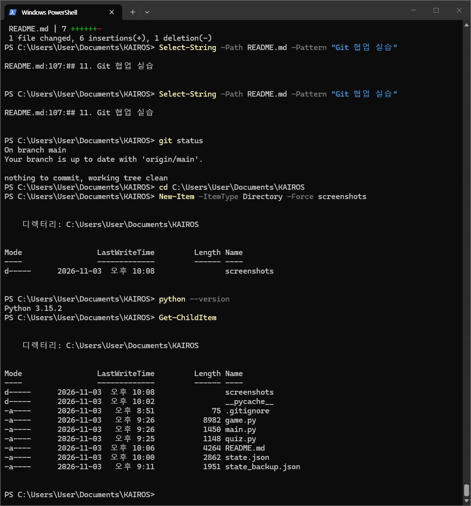
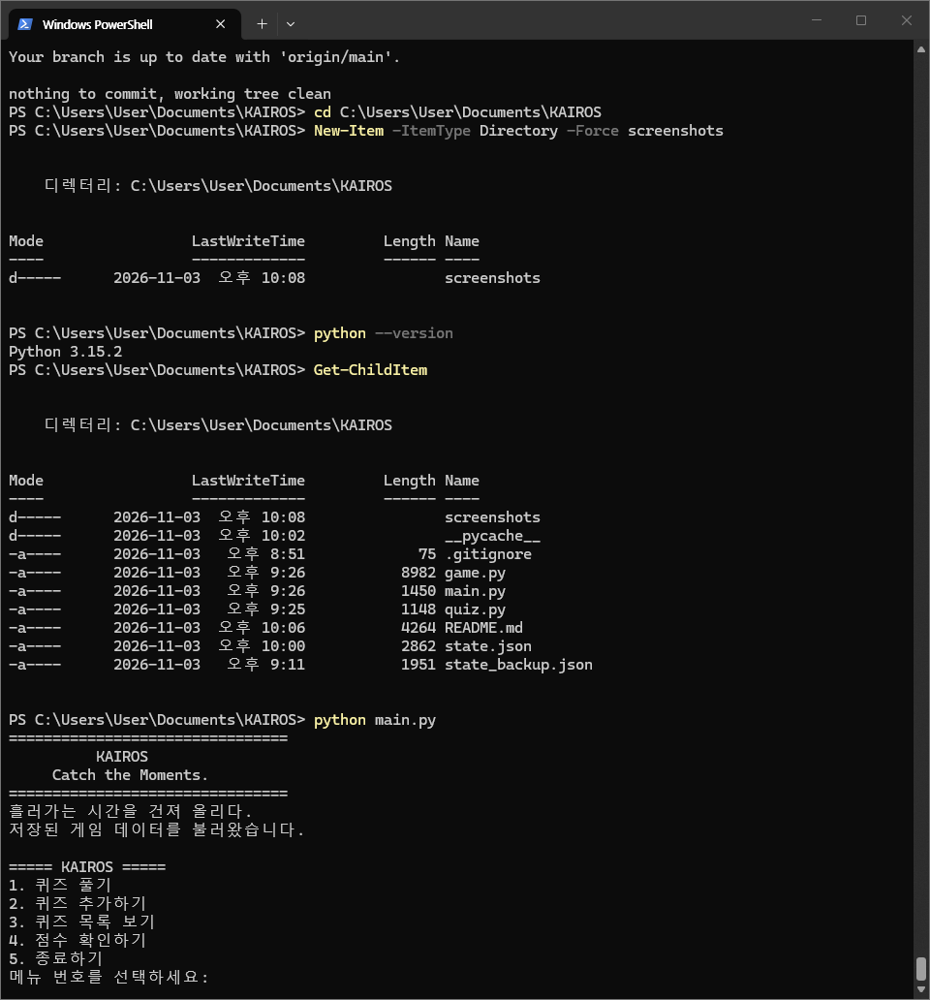
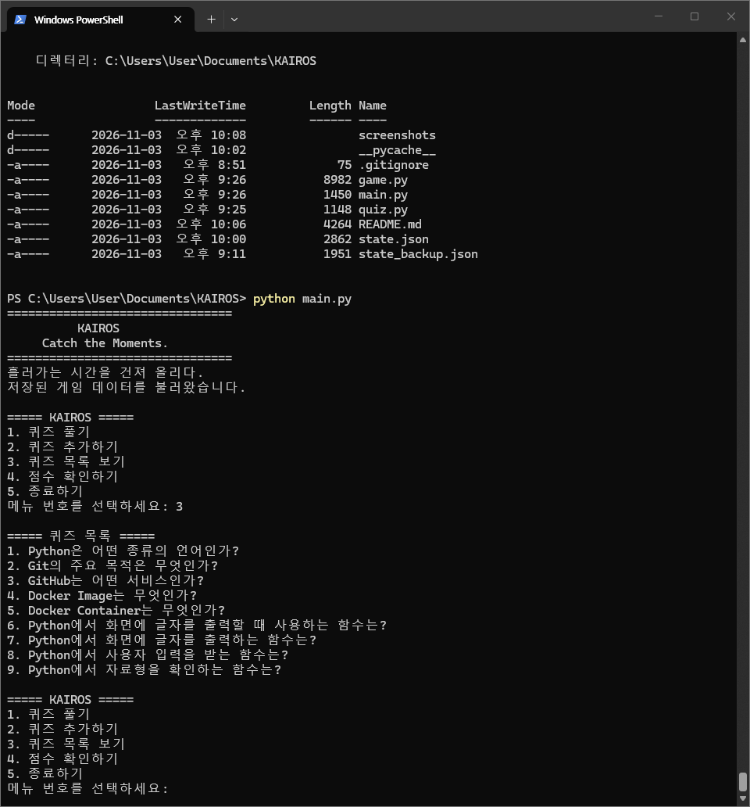

# KAIROS

### Catch the Moments.
**흘러가는 시간을 건져 올리다.**

붙잡지 않으면 흘러가는 시간 속에서, 기억하고 기록하고 복습하는 퀴즈 게임

---

## 1. 프로젝트 소개

KAIROS는 강의를 통해 학습한 내용을 퀴즈로 풀어보며 학습자의 이해도를 확인하고, 반복적인 복습을 통해 학습 효과를 높이는 Python 기반 콘솔 퀴즈 게임이다.

사용자는 등록된 퀴즈를 풀거나 새로운 문제를 추가할 수 있으며, 자신의 누적 점수와 최고 기록을 확인할 수 있다.

## 2. 개발 목적 및 주제 선정 이유

### 개발 목적

- 강의에서 학습한 핵심 개념 복습
- 퀴즈를 통한 학습 이해도 확인
- 반복적인 문제 풀이를 통한 학습 효과 향상
- 게임 기록의 저장 및 관리를 통한 지속적인 학습 지원

### 주제 선정 이유

개발 과정에서 학습한 Python, Git, GitHub, Docker의 핵심 개념을 퀴즈로 구성하였다.

개발 과정에서 접한 주요 용어와 기능을 스스로 점검하고, 반복적인 문제 풀이를 통해 학습 내용을 복습할 수 있도록 주제를 선정하였다.

## 3. 개발 환경

| 항목 | 환경 |
|---|---|
| Programming Language | Python 3.10 이상 |
| Platform | Windows Console |
| Data Storage | JSON |
| Version Control | Git |
| Remote Repository | GitHub |
| External Libraries | Python 표준 라이브러리 |

### 개발 환경 확인

Python 실행 환경과 프로젝트 파일 구성을 확인하였다.

## 4. 주요 기능

### 4-1. 메인 메뉴

프로그램을 실행하면 KAIROS의 시작 화면과 함께 주요 기능을 선택할 수 있는 메뉴가 표시된다.

### 4-2. 퀴즈 목록 조회

등록된 퀴즈를 목록으로 확인할 수 있다. 각 문제와 선택지를 확인하여 게임에 등록된 문제를 관리할 수 있다.

### 4-3. 퀴즈 풀이 및 자동 채점

등록된 퀴즈를 순서대로 풀고, 입력한 답안을 정답과 비교하여 자동으로 채